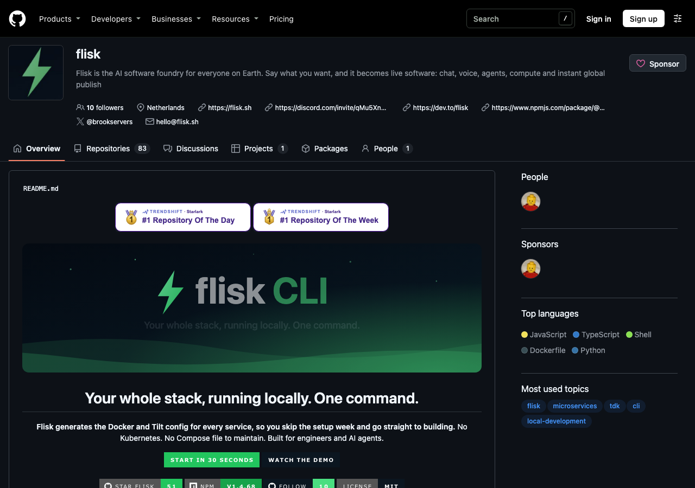
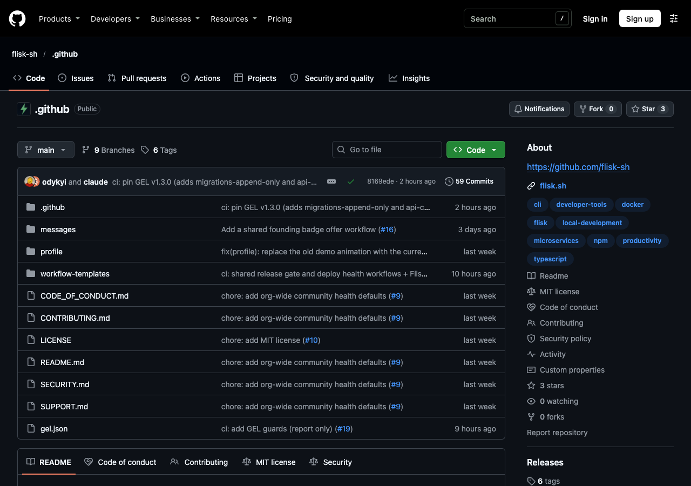
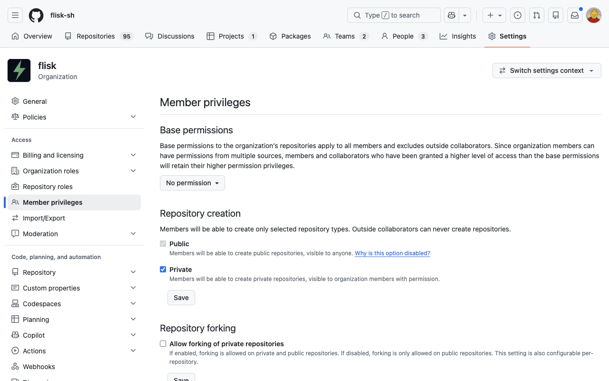

# Configure your GitHub organization

Settings live under your organization, **Settings**.

## Profile

- **Profile**: display name, description, URL, email, location. Fill these in; they show on your public page.
- **Profile README**: create a repository named `.github` and add `profile/README.md`. Its content appears on the organization page. Start from [templates/organization-profile/README.md](../templates/organization-profile/README.md).

What the result looks like on a public organization page (the README at the bottom comes from `profile/README.md`):

## Organization-wide community files

A public repository named `.github` supplies default community health files for every repository in the organization that lacks its own: `CODE_OF_CONDUCT.md`, `CONTRIBUTING.md`, `SECURITY.md`, `SUPPORT.md`, issue templates and pull request templates. Start from [templates/community/](../templates/community).

## Member privileges

Under **Member privileges**:

| Setting | Recommended |
| --- | --- |
| Base permissions | Read |
| Repository creation | Private only for members, or none |
| Forking private repositories | Off |
| Pages creation | Per your policy |
| Admin repository permissions | Owners only can delete or transfer |

## Defaults for new repositories

Under **Code security**, enable the configuration that turns on Dependabot alerts, secret scanning and push protection for new repositories.

## Billing and owners

Add a second owner and a billing manager. Keep the owner count small.
