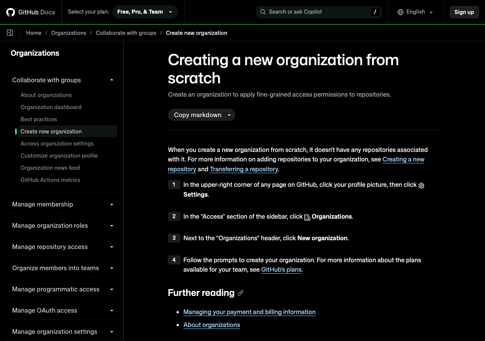

# How to create an organization in GitHub

Official reference: [Creating a new organization from scratch](https://docs.github.com/en/organizations/collaborating-with-groups-in-organizations/creating-a-new-organization-from-scratch). If a screen differs from this page, trust GitHub's docs and open an issue here.

## Before you start

- Decide who will be the **owners** (at least two, so nobody is locked out).
- Pick the name ([below](#choose-the-name)).
- Pick a plan. Free allows unlimited public and private repositories with a limited feature set; paid plans add things like required reviewers on private repos and SAML SSO.

## Steps

1. Sign in at github.com.
2. Click your profile picture, then **Your organizations**, then **New organization**.
3. Choose a plan.
4. Fill in **Organization account name**, **Contact email** and whether the organization belongs to **My personal account** or **A business or institution**.
5. Verify you are human and click **Next**, then **Complete setup**.
6. Optionally invite members by username or email.

Creating an organization through the GitHub web UI is the supported route. This kit does not automate it. (GitHub Enterprise Cloud with managed users has its own provisioning flow.)

## Choose the name

- Lowercase, letters, digits and single hyphens. 39 characters maximum.
- Check that the name is free on github.com, npm, your domain and the container registry you plan to use.
- Avoid trademarks you do not own. GitHub can reclaim names.
- Renaming later is possible but breaks clone URLs, badges and links until redirects settle.

## After creation: first 15 minutes

1. Add a second owner.
2. Require two-factor authentication ([security guide](organization-security.md)).
3. Set base permissions to Read ([teams guide](teams-and-permissions.md)).
4. Create the `.github` repository for shared files ([configure guide](configure-organization.md)).
5. Run the scripts in this kit.

## Troubleshooting

- **Name already taken.** It may belong to a user, not an organization. Users and organizations share one namespace.
- **No "New organization" button.** Enterprise-managed accounts may be blocked from creating organizations; ask your enterprise owner.
- **Invite not arriving.** Check the invitee's spam folder, or use their username instead of email.
